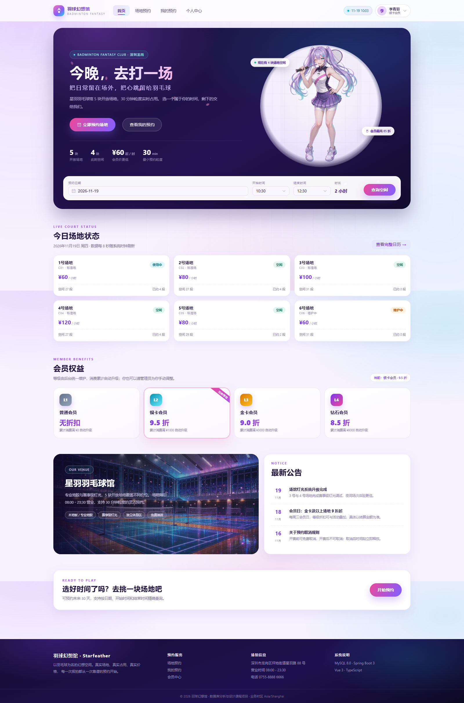
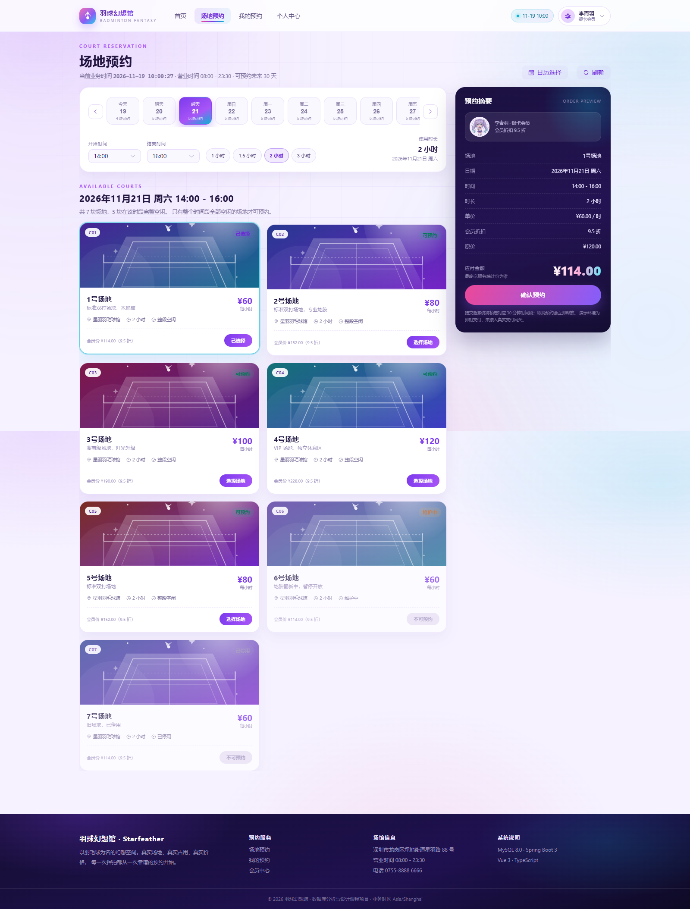
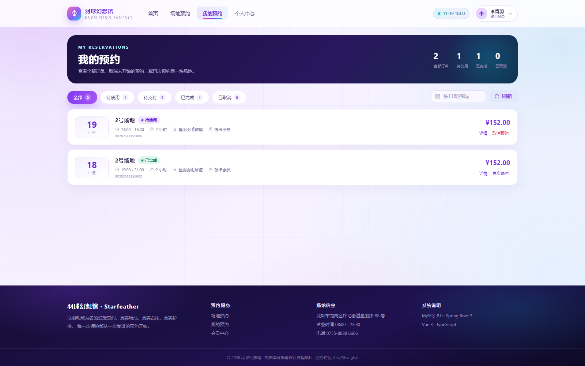
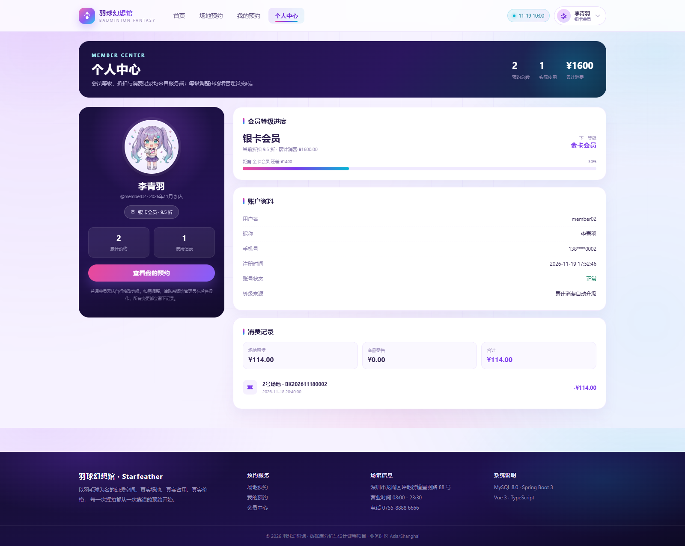
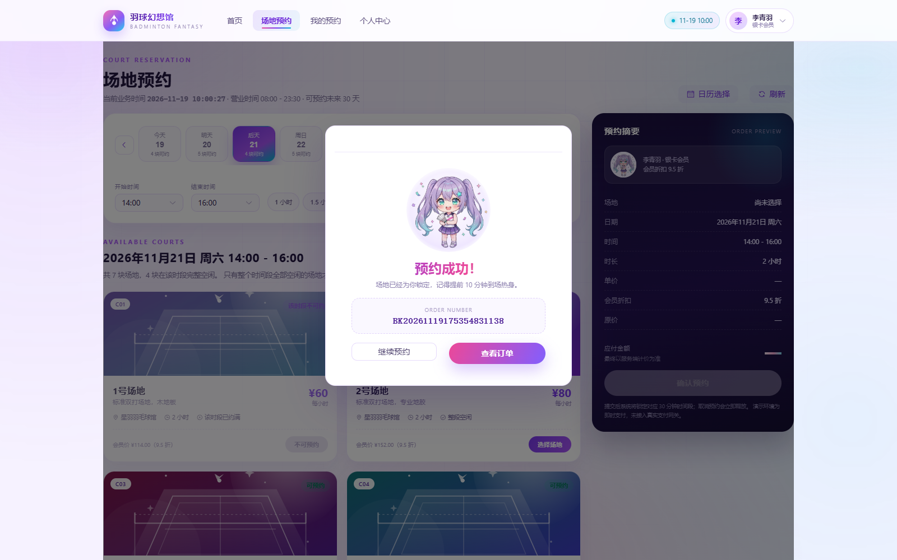
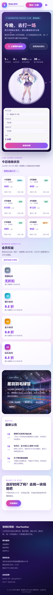
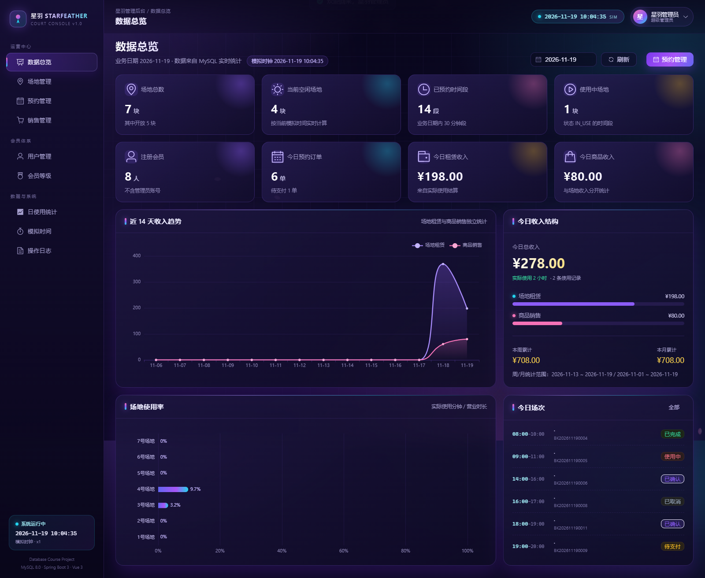
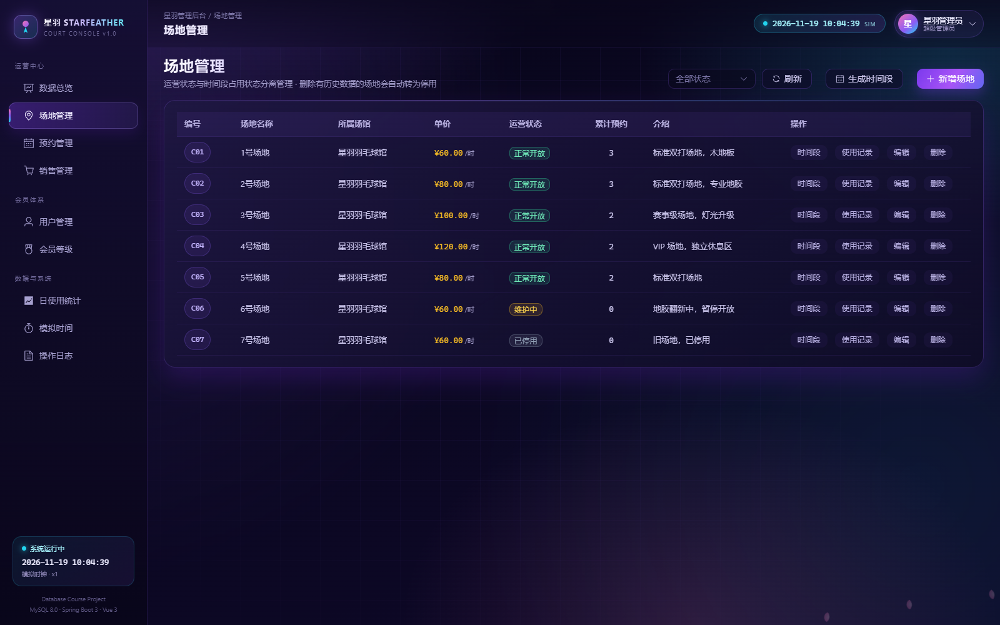
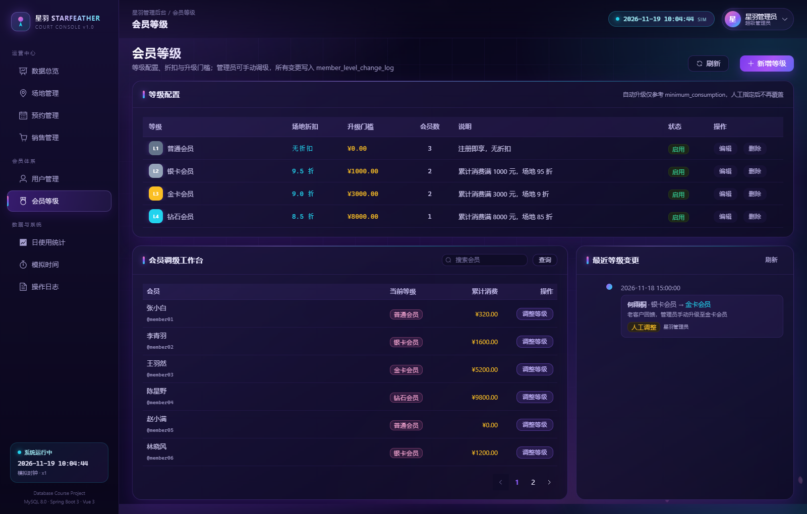
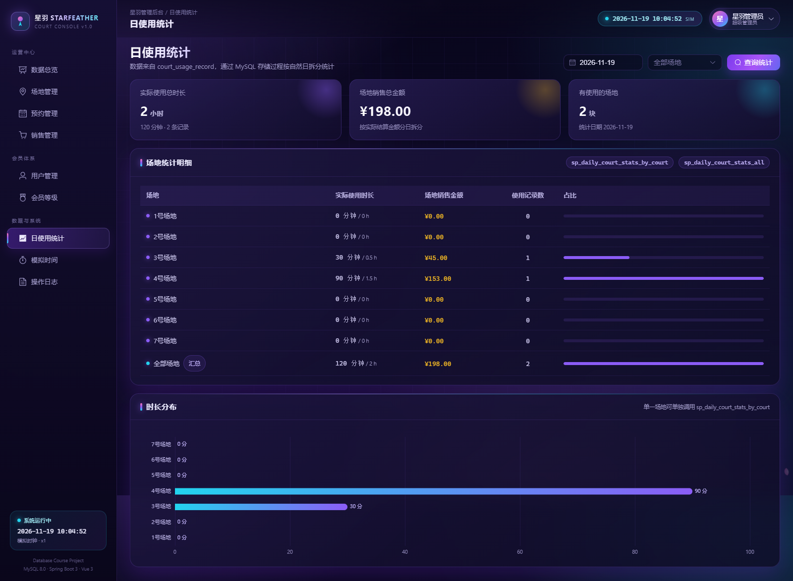

# 羽球幻想馆 · 羽毛球场地管理系统

> 数据库分析与设计课程项目，按真实商业软件标准实现。  
> MySQL 8.0 · Spring Boot 3 · MyBatis-Plus · Spring Security + JWT · Vue 3 · TypeScript · Element Plus · ECharts

一套可运行的羽毛球场地系统，包含面向消费者的 **羽球幻想馆 C 端预约站** 和独立的 **后台管理端**。数据库触发器、视图、存储过程全部真实创建并在业务链路中调用，不是 Java 代码模拟。



## 0. 双端入口

### 已部署（发给组员直接用）

| 端 | 地址 | 说明 |
| --- | --- | --- |
| **公网（任何网络）** | <https://nursing-below-rev-performs.trycloudflare.com/> | 本机需保持开机联网；重启隧道后地址会变 |
| **局域网（同一 WiFi）** | <http://10.121.52.226:8088/> | 更快；需先管理员运行 `scripts\allow-lan-firewall.bat` |
| C 端 · 羽球幻想馆 | `/club/home` | 首页、场地预约、我的预约、个人中心 |
| 会员登录/注册 | `/club/login` | 普通消费者入口，可自行注册 |
| 后台管理端 | `/login` | `admin / admin123`，9 个管理页面 |

一键启动生产模式：`scripts\start-prod.bat`；开启公网链接：`scripts\start-tunnel.bat`。
详细说明见 [部署与分享说明](docs/部署与分享说明.md)。

### 本地开发

| 端 | 地址 | 说明 |
| --- | --- | --- |
| C 端 · 羽球幻想馆 | <http://127.0.0.1:5173/> | 首页、场地预约、我的预约、个人中心 |
| 会员登录/注册 | <http://127.0.0.1:5173/club/login> | 普通消费者入口 |
| 后台管理端 | <http://127.0.0.1:5173/login> | 管理员入口，9 个管理页面 |

C 端与后台共用一套 Spring Boot / MySQL，但页面、布局、导航和权限完全分离。C 端不出现任何管理按钮；普通会员访问 `/dashboard` 会被重定向回 C 端。

## 1. 功能概览

### 1.1 C 端 · 羽球幻想馆

| 模块 | 能力 |
| --- | --- |
| 首页 | 二次元 Banner、原创吉祥物星羽、快捷预约、今日场地状态、会员权益、场馆介绍、公告 |
| 场地预约 | 14 天日期条 + 日历、前后一天切换、任意可预约日期、开始/结束时间、1/1.5/2/3 小时快捷时长 |
| 可预约查询 | 查询视图 `v_available_court_slots`，整段空闲才可预约；展示空闲、已预约、使用中、维护中、已停用 |
| 预约确认 | 用户/等级/场地/时间/时长/单价/折扣/原价/应付金额，提交 loading 防重复 |
| 预约结果 | 成功页展示订单号；冲突、未登录、网络异常均有明确提示并刷新真实状态 |
| 我的预约 | 全部/待使用/待支付/已完成/已取消、按日期筛选、详情抽屉、取消、支付、再次预约 |
| 个人中心 | 头像、昵称、注册时间、会员等级、折扣、累计消费、等级进度、消费记录、调级记录 |
| 时间系统 | 所有日期与状态以服务端模拟时钟为准，管理员改时间后客户端刷新即同步 |

### 1.2 后台管理端

| 模块 | 能力 |
| --- | --- |
| 数据总览 | 场地/会员/预约/收入/使用时长指标，近 14 天收入趋势、场地使用率、今日场次 |
| 场地管理 | 增删改查、单价与运营状态、30 分钟时间段日历、历史使用记录、批量生成未来时间段 |
| 用户管理 | 搜索、详情、资料修改、禁用/恢复、预约历史、消费历史 |
| 会员等级 | 等级配置（折扣/门槛）、会员手动调级、原因必填、变更日志、恢复自动升级 |
| 预约管理 | 多条件筛选、详情、取消、签到、结束使用、未到场、时间段释放 |
| 销售管理 | 商品与库存、商品销售单、订单明细、租赁/商品收入分列统计（日/月） |
| 日使用统计 | 真实调用存储过程，单场地与全部场地汇总，支持切换日期 |
| 模拟时间 | 模拟日期/时间、暂停/恢复、流速、REAL/SIMULATED 模式、快捷跳转 |
| 操作日志 | AOP 记录管理员写操作（模块、动作、目标、IP、详情） |

## 2. 核心设计

### 2.1 场地状态与时间段状态分离

- `court.operational_status`：`OPEN / MAINTENANCE / DISABLED`，描述场地是否可营业。
- `court_slot.slot_status`：`AVAILABLE / BOOKED / IN_USE / CLOSED`，描述某天某个 30 分钟段是否被占用。
- 唯一索引 `uk_court_slot_start (court_id, slot_start)` 保证同一场地同一时间段只有一条记录。

同一场地上午被预约、下午仍可预约；取消只释放 `booking_id` 对应的那几段，不会影响其他订单。

### 2.2 真实数据库对象

| 对象 | 名称 | 说明 |
| --- | --- | --- |
| 触发器 | `trg_booking_after_insert` | CONFIRMED 预约创建后占用区间内全部 30 分钟段，并校验数量一致 |
| 触发器 | `trg_booking_after_update` | 取消/未到场释放本订单时间段；支付确认占场；使用中标记 IN_USE |
| 触发器 | `trg_booking_before_update` | 禁止修改已创建预约的场地与时间 |
| 视图 | `v_available_court_slots` | 场馆正常 + 场地开放 + 时间段空闲，预约查询接口直接使用 |
| 视图 | `v_booking_detail` | 预约 + 会员 + 等级 + 场地 + 实际使用聚合 |
| 视图 | `v_member_consumption_history` | 场地租赁与商品消费历史 |
| 存储过程 | `sp_generate_court_slots` | 按营业时间批量生成 30 分钟时间段（幂等） |
| 存储过程 | `sp_daily_court_stats_by_court` | 单场地某日实际使用分钟/小时/销售额，跨自然日按重叠分钟拆分 |
| 存储过程 | `sp_daily_court_stats_all` | 全部场地某日汇总，无数据返回 0 而非 NULL |

### 2.3 预约并发安全

后端事务流程：

1. 幂等检查 `request_id`（唯一索引兜底）。
2. 校验场地运营状态、营业时间、30 分钟对齐、未来 30 天范围。
3. 检查区间时间段数量，仅在缺失时按区间补齐（避免整日 `INSERT IGNORE` 与行锁交叉死锁）。
4. `SELECT ... FOR UPDATE` 按 `slot_start` 锁定区间内所有时间段。
5. 校验“数量 = 时长/30 且全部 AVAILABLE”。
6. 服务端按数据库单价与会员折扣计价。
7. 插入预约，由 `trg_booking_after_insert` 占用时间段并再次校验；任一失败整个事务回滚。

并发实测：6 线程抢同一时段，1 单成功、5 单 409，无重复占用、无 500。

### 2.4 统一模拟时钟

`system_setting` 保存 `simulated_now / base_real_at / clock_mode / clock_paused / clock_speed / demo_mode`。

有效时间 = 模拟基准 + (真实经过秒数 × 流速)，暂停时冻结。所有业务接口通过 `SimulatedClockService` 获取时间；存储过程统计日期由接口显式传参，不依赖 `NOW()`。

## 3. 技术架构

```
Vue 3 + Vite + TS + Element Plus + Pinia + ECharts
                    │ /api (Axios, JWT)
Spring Boot 3.2 + Spring Security + MyBatis-Plus
                    │ JDBC (HikariCP)
MySQL 8.0（表 / 触发器 / 视图 / 存储过程）
```

## 4. 目录结构

```
.
├─ backend/                 Spring Boot 服务端
│  ├─ src/main/java/com/badminton/
│  │  ├─ controller/         REST 接口
│  │  ├─ service/            业务与事务
│  │  ├─ mapper/             MyBatis-Plus Mapper
│  │  ├─ entity/ dto/        实体与传输对象
│  │  ├─ security/           JWT 认证
│  │  ├─ aspect/             管理操作日志 AOP
│  │  └─ config/             安全/分页/OpenAPI/Jackson
│  └─ src/main/resources/mapper/*.xml
├─ frontend/                Vue 3 工程
│  ├─ src/views/            9 个后台页面 + 管理登录
│  ├─ src/views/client/     C 端首页 / 预约 / 我的预约 / 个人中心 / 登录
│  ├─ src/layout/           AdminLayout / ClientLayout
│  └─ src/assets/mascot/    原创吉祥物与场馆插画（WebP）
├─ database/                01~09 SQL 脚本
├─ docs/                    设计说明书 / 接口 / 部署 / 测试记录 / C 端说明
├─ scripts/                 启动、初始化、测试脚本
└─ README.md
```

## 5. 快速启动

当前开发机已安装便携式运行环境（MySQL 8.0.28 / JDK 17 / Maven 3.9.16 / Node 22）。

### 5.1 分享给组员（生产模式）

```bat
rem 打包前端（首次或代码变更后执行）
cd frontend && npm run build && cd ..

rem 一键启动 MySQL + 后端(8080) + 静态服务(8088)
scripts\start-prod.bat

rem 需要公网链接时（另开窗口）
scripts\start-tunnel.bat

rem 需要局域网访问时（仅首次，管理员权限）
scripts\allow-lan-firewall.bat
```

### 5.2 本地开发模式

```bat
rem 1. 初始化 MySQL（仅首次）
scripts\init-mysql.bat

rem 2. 建库并导入演示数据（可重复执行，会重建数据库）
scripts\init-db.bat

rem 3. 一键启动 MySQL + 后端 + 前端
scripts\start-all.bat
```

访问：

- **C 端首页：<http://127.0.0.1:5173/>**（根路径自动进入羽球幻想馆）
- C 端登录/注册：<http://127.0.0.1:5173/club/login>
- C 端场地预约：<http://127.0.0.1:5173/club/booking>
- 管理端：<http://127.0.0.1:5173/login>
- Swagger：<http://127.0.0.1:8080/swagger-ui.html>

演示账号：

| 角色 | 用户名 | 密码 |
| --- | --- | --- |
| 管理员 | `admin` | `admin123` |
| 会员（普通） | `member01` | `123456` |
| 会员（银卡） | `member02` | `123456` |
| 会员（金卡） | `member03` | `123456` |

> C 端登录页提供了 `member02 / 123456` 的一键填充按钮，方便演示会员价。

## 6. 验证

```bat
rem 数据库 10 项测试（事务内执行并回滚，不污染数据）
mysql -h127.0.0.1 -P3307 -uroot -proot123 --default-character-set=utf8mb4 --table --force < database\08_test_cases.sql

rem REST API 端到端冒烟测试（自动寻找空闲时段，23 项断言）
python scripts\api_smoke_test.py

rem 并发预约测试（6 线程抢同一时段，预期 1 成功 / 5 冲突）
python scripts\concurrency_test.py 6
```

C 端另通过 Edge + Playwright 完成 22 项端到端验收（注册、切日期、预约、取消、个人中心、模拟时间、移动端），结果见测试记录。

真实执行结果见 [docs/测试记录.md](docs/测试记录.md)。

## 7. 文档

- [部署与分享说明](docs/部署与分享说明.md)（公网/局域网地址、一键脚本、组员操作指引、排错）
- [C 端前端说明](docs/C端前端说明.md)（页面、时间系统、组件、接口、状态与已知问题）
- [数据库设计说明书](docs/数据库设计说明书.md)（含 Mermaid E-R 图、数据字典、触发器/视图/存储过程设计）
- [前后端接口对接说明](docs/接口对接说明.md)
- [部署与启动说明](docs/部署启动说明.md)（本地开发环境）
- [测试记录](docs/测试记录.md)

## 8. 界面预览

### C 端 · 羽球幻想馆

| 首页 | 场地预约 |
| --- | --- |
|  |  |

| 我的预约 | 个人中心 |
| --- | --- |
|  |  |

| 预约成功 | 移动端首页 |
| --- | --- |
|  |  |

### 后台管理端

| 数据总览 | 场地管理 |
| --- | --- |
|  |  |

| 会员等级 | 日使用统计 |
| --- | --- |
|  |  |
