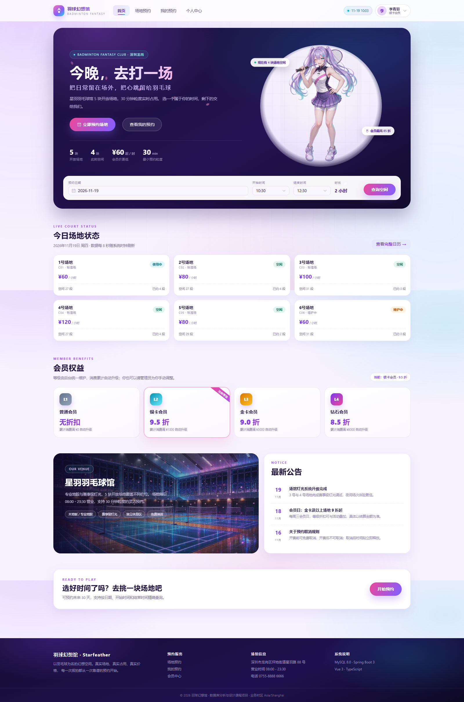
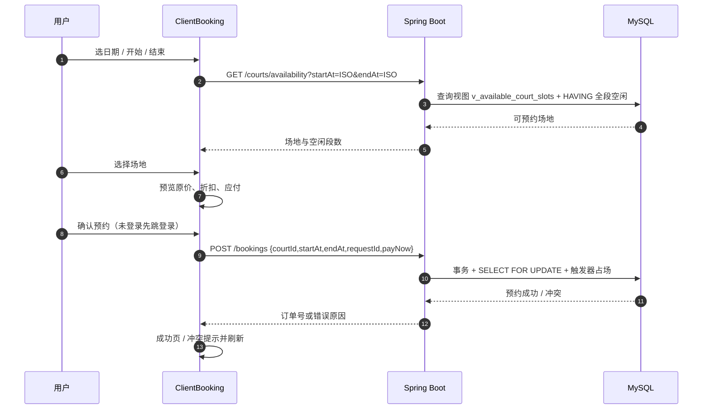

# 羽球幻想馆 · C 端前端说明

- 产品名：羽球幻想馆（Badminton Fantasy Club）
- 定位：面向羽毛球消费者的场地预约客户端
- 技术栈：Vue 3 + Vite 5 + TypeScript + Vue Router + Pinia + Axios + Element Plus + ECharts
- 业务时区：Asia/Shanghai
- 入口：<http://127.0.0.1:5173/>



---

## 1. 双端隔离

| 端 | 路径 | 权限 |
| --- | --- | --- |
| C 端 | `/club/**` | 首页/预约公开；我的预约/个人中心需登录 |
| 后台 | `/dashboard`、`/courts`… | 仅 `ADMIN` |
| 管理登录 | `/login` | 公开（管理员） |
| 会员登录 | `/club/login` | 公开 |

- C 端导航不出现任何管理入口；管理员登录 C 端后会看到「进入管理后台」下拉项。
- 普通会员访问 `/dashboard` 会被路由守卫重定向到 `/club/home`；后端 `/api/admin/**` 仍会返回 403，前端拦截不是安全边界。
- 原 `/portal` 保留 302 语义，重定向到 `/club/home`。

## 2. 页面与路由

| 路由 | 页面 | 功能 |
| --- | --- | --- |
| `/club/home` | 首页 | Banner、吉祥物、快捷预约、今日场地状态、会员权益、场馆、公告 |
| `/club/booking` | 场地预约 | 日期条/日历、前后一天、时间选择、时长快捷、可预约场地、确认与成功 |
| `/club/bookings` | 我的预约 | 状态 Tab、日期筛选、详情抽屉、取消、支付、再次预约 |
| `/club/profile` | 个人中心 | 会员卡、等级进度、账户资料、消费记录、调级记录 |
| `/club/login` | 登录/注册 | 会员登录、注册、演示账号填充 |

所有页面支持 1600px 桌面、1180px 笔记本、980px 平板、390px 手机。手机端导航折叠为汉堡菜单，日期条横向滑动，预约摘要自动下移。

## 3. 视觉设计

### 3.1 风格

- 深色霓虹 Hero + 浅色内容区，避免传统蓝白管理系统观感。
- 主色：紫 `#7c3aed`、粉 `#ec4899`、青 `#06b6d4`，辅以金色价格。
- 玻璃拟态导航、渐变按钮、卡片悬浮、樱花/星光/运动轨迹装饰。
- 字体使用系统中文字体栈，数字使用等宽变体，金额与时间段对齐。

### 3.2 原创吉祥物「星羽」

- 原创角色，不依赖任何现有动漫 IP。
- 设定：22 岁、长紫发双马尾、青色星形发夹、白紫羽毛球运动服、紫色百褶裙、白色球鞋。
- 资源目录：`frontend/src/assets/mascot/`
  - `mascot-hero.webp`：首页与登录页主立绘
  - `mascot-chibi.webp`：预约成功、空状态、头像默认图
  - `venue-night.webp`：场馆夜景氛围图
- 立绘统一使用同一角色设计，通过 CSS 圆形容器、网格背景、multiply 混合模式融入页面。
- 图片已压缩为 WebP（73KB / 35KB / 309KB），本地加载，不依赖外链。

### 3.3 组件复用

```
frontend/src/
├─ components/client/
│  ├─ MascotFigure.vue      吉祥物图片
│  ├─ CourtArt.vue          SVG 球场插画（5 套配色）
│  ├─ StatusBadge.vue       预约状态胶囊
│  ├─ EmptyState.vue        空状态 + Q 版角色
│  └─ SectionHead.vue       区块标题
├─ layout/ClientLayout.vue  导航、时钟、用户菜单、页脚、移动菜单
├─ views/client/            5 个 C 端页面
├─ api/client.ts            C 端接口集中管理
├─ stores/clock.ts          服务端时钟轮询
├─ stores/auth.ts           登录态
├─ styles/client.css        C 端主题（独立于后台）
└─ utils/time.ts            统一时间处理
```

## 4. 时间系统（重点修复）

### 4.1 服务端时钟

- 前端通过 `GET /api/system/clock` 获取 `effectiveNow / businessDate`，Pinia `clock` store 每 8 秒轮询。
- 所有日期默认值、日期范围、可取消判断、过期判断都以 `effectiveNow` 为准，不写死日期。
- 管理员在后台修改模拟时间后，C 端下一次轮询或刷新页面即同步；C 端没有任何修改时钟的入口。
- 顶部导航展示业务时间，鼠标悬浮提示「由场馆统一校准」。

### 4.2 日期选择

- 14 天日期条：显示「今天/明天/后天/周X」、日期、该时段可约场地数。
- 左右箭头：切换前一天/后一天，自动限制在 `[今天, 今天+30天]`。
- 日历弹窗：Element Plus 日历，点击任意可预约日期立即查询。
- 支持 URL 参数：`/club/booking?date=2026-11-21&start=14:00&end=16:00`，便于分享与登录后回跳。
- 日期范围由后端预生成未来 30 天时间段支撑（种子脚本生成 38 天，共 7068 段）。

### 4.3 时间与时长

- 开始/结束时间按 30 分钟步长生成，范围取自场馆 `opening_time ~ closing_time`。
- 快捷时长 1 / 1.5 / 2 / 3 小时，自动计算结束时间并校验不越过闭馆。
- 时长 = 结束 - 开始，展示为「2 小时」「1 小时 30 分」。
- 提交时转换为 ISO 8601 带时区：`2026-11-20T14:00:00+08:00`。
- 后端 `DateTimeUtils` 同时兼容 ISO 8601 带偏移、`yyyy-MM-dd HH:mm:ss`、`yyyy-MM-dd`。

## 5. 预约流程



关键点：

- 前端价格只是预览，最终金额以服务端返回为准。
- `requestId` 每次确认生成 UUID，重复点击/网络重试沿用同一个，后端幂等。
- 提交按钮进入 loading 并禁用，避免重复提交。
- 成功后立即重新查询可预约列表，已占用场地不再显示为可预约。
- 冲突时关闭确认框、刷新列表并展示后端原因。

## 6. 接口对接

环境变量：

```bash
# frontend/.env.development（默认走 Vite 代理）
VITE_API_BASE_URL=/api

# frontend/.env.example（直连后端时复制为 .env.local）
VITE_API_BASE_URL=http://127.0.0.1:8080/api
```

C 端使用的接口：

| 方法 | 路径 | 说明 |
| --- | --- | --- |
| POST | `/api/auth/register` | 注册并自动登录 |
| POST | `/api/auth/login` | 登录 |
| GET | `/api/users/me` | 当前用户与等级 |
| GET | `/api/system/clock` | 服务端模拟时间 |
| GET | `/api/venues` | 场馆与营业时间 |
| GET | `/api/courts` | 场地列表 |
| GET | `/api/courts/overview?date=` | 某日场地汇总与当前状态 |
| GET | `/api/courts/availability?startAt=&endAt=` | 整段空闲场地（视图） |
| GET | `/api/courts/{id}/slots?date=` | 场地某日时间段 |
| GET | `/api/member-levels` | 公开会员等级与折扣 |
| GET | `/api/members/me` | 我的会员资料、预约数、消费历史、调级历史 |
| GET | `/api/users/me/bookings` | 我的预约（状态、日期、分页） |
| GET | `/api/users/me/booking-stats` | 各状态预约数量 |
| GET | `/api/users/me/orders` | 消费记录与租赁/商品合计 |
| POST | `/api/bookings` | 创建预约 |
| GET | `/api/bookings/{id}` | 预约详情（含时间段与实际使用） |
| PATCH | `/api/bookings/{id}/cancel` | 取消预约 |
| PATCH | `/api/bookings/{id}/pay` | 支付待支付订单 |

统一响应、错误码、权限矩阵见 [接口对接说明](接口对接说明.md)。

> 本项目未启用 Mock 模式。页面数据全部来自 MySQL；后端未启动时会展示加载失败/空状态，不会伪造预约成功。

## 7. 状态覆盖

| 状态 | 处理 |
| --- | --- |
| 正常加载 | 卡片、表格显示 `v-loading`，不阻塞导航 |
| 加载失败 | 场地列表显示错误提示与空状态，可点「刷新」重试 |
| 空数据 | 使用 Q 版角色空状态，提示换日期/时间 |
| 预约成功 | 全屏成功弹窗 + 订单号 + 查看订单/继续预约 |
| 预约冲突 | 409 提示具体原因，关闭确认框并刷新可预约列表 |
| 未登录 | 预约前跳转 `/club/login?redirect=...`，登录后回到原日期与时间 |
| 权限不足 | 普通会员访问后台被重定向；管理接口返回 403 |
| 网络异常 | Axios 统一提示，保留当前选择，可重试 |

## 8. 本地运行

环境要求：Node.js >= 18（本机 22.22.2）、npm >= 9。

```bash
cd frontend
npm install
npm run dev        # http://127.0.0.1:5173
npm run build      # 生产构建到 dist/
npm run type-check # vue-tsc 类型检查
```

主要依赖：`vue`、`vue-router`、`pinia`、`axios`、`element-plus`、`@element-plus/icons-vue`、`echarts`、`dayjs`。

后端需先启动（默认 8080）。Vite 代理配置见 `frontend/vite.config.ts`；接口地址通过 `VITE_API_BASE_URL` 配置。

## 9. 测试结果

使用 Microsoft Edge 无头浏览器（Playwright）真实操作页面，22 项断言全部通过：

| # | 场景 | 结果 |
| --- | --- | --- |
| 1 | 游客浏览首页，场地卡片 ≥ 5 | PASS |
| 2 | 首页显示服务端业务时间 | PASS |
| 3 | 预约页 14 天日期条 | PASS |
| 4 | 切换未来日期并重新查询 | PASS |
| 5 | 注册新会员并自动登录 | PASS |
| 6 | 等级来自服务端（普通会员/无折扣） | PASS |
| 7 | 未来日期存在可预约场地 | PASS |
| 8 | 摘要显示会员与折扣 | PASS |
| 9 | 前端预估价 = 单价 × 时长 | PASS |
| 10 | 确认弹窗信息完整 | PASS |
| 11 | 真实预约成功并返回订单号 | PASS |
| 12 | 成功后该场地不再可预约 | PASS |
| 13 | 我的预约出现新订单 | PASS |
| 14 | 取消预约成功并更新状态 | PASS |
| 15 | 取消后时间段恢复可用 | PASS |
| 16 | 个人中心显示资料与等级 | PASS |
| 17 | 个人中心展示消费记录 | PASS |
| 18 | 普通会员访问后台被重定向 | PASS |
| 19 | 模拟时间变化后客户端同步 | PASS |
| 20 | 移动端首页无横向溢出 | PASS |
| 21 | 移动端预约页无横向溢出 | PASS |
| 22 | 全流程无 console / pageerror | PASS |

真实输出与截图见 [测试记录](测试记录.md)。

## 10. 已知问题

1. 支付为演示实现，确认预约即视为支付成功；没有真实支付网关。
2. 预约最多未来 30 天（由时间段预生成与后端校验共同限制），不支持无限期预约。
3. 不支持跨午夜预约；跨自然日统计针对实际使用超时。
4. 日期条一次展示 14 天，更多日期通过日历选择；日历不展示每日可约数量，避免一次请求整月。
5. 会员不能修改头像与资料（后端未开放 C 端资料修改接口），当前仅展示。
6. 消费记录来自已完成使用与已支付商品订单，预约创建但未使用不会计入消费。
7. 移动端已适配 390px 常用宽度，超小屏（<360px）未专门优化。
