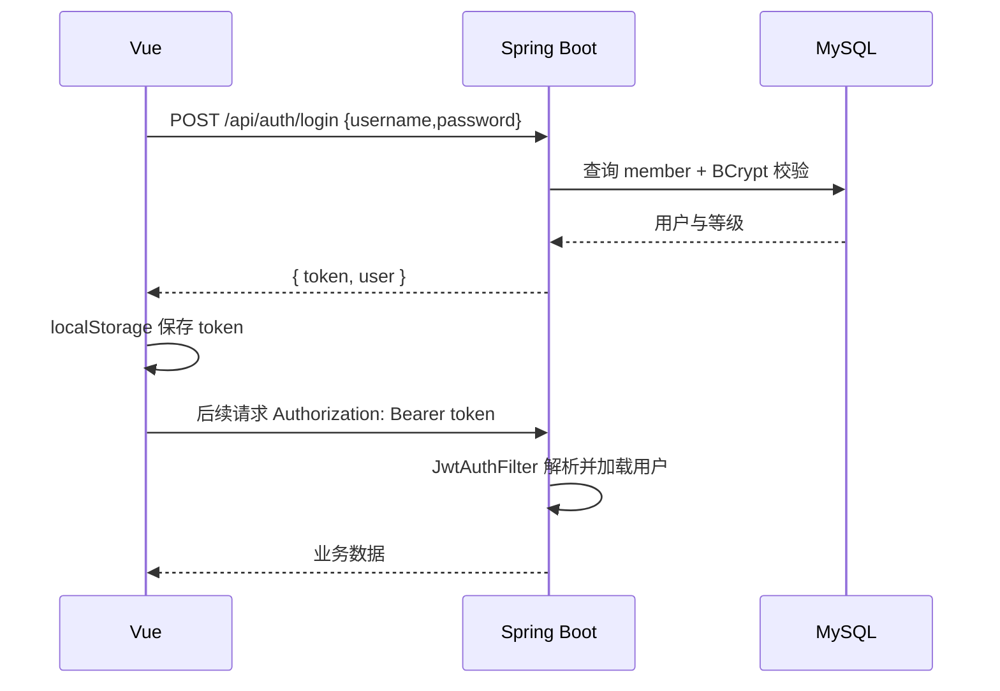

# 前后端接口对接说明

## 1. 基础约定

| 项目 | 约定 |
| --- | --- |
| Base URL | `http://127.0.0.1:8080/api` |
| 前端开发代理 | `/api` → `http://127.0.0.1:8080`（`frontend/vite.config.ts`） |
| 数据格式 | `application/json; charset=utf-8` |
| 时间格式 | `yyyy-MM-dd HH:mm:ss`；日期 `yyyy-MM-dd` |
| 金额 | JSON number（数据库 `DECIMAL`，Java `BigDecimal`），保留两位小数 |
| 认证 | `Authorization: Bearer <JWT>` |
| 分页 | 请求 `page`（从 1 开始）、`size`；响应 `{ records, total, page, size }` |
| 接口文档 | <http://127.0.0.1:8080/swagger-ui.html>（离线副本 `docs/openapi.json`，51 个路径） |

### 1.1 统一响应

```json
{
  "code": 200,
  "message": "success",
  "data": {},
  "timestamp": "2026-11-19 10:00:00"
}
```

失败时 `code` 为 HTTP 状态码，`data` 为 `null`：

```json
{
  "code": 409,
  "message": "预约失败：所选时间段已被占用，请刷新后重试",
  "data": null,
  "timestamp": "2026-11-19 10:00:00"
}
```

### 1.2 状态码

| HTTP | 场景 |
| --- | --- |
| 200 | 成功 |
| 400 | 参数校验失败、时间格式错误、业务前置条件不满足 |
| 401 | 未登录 / Token 过期 / 密码错误 |
| 403 | 已登录但无权限（会员访问管理接口） |
| 404 | 资源不存在 |
| 409 | 冲突：时间段被占用、用户名/手机号重复、库存不足 |
| 500 | 未预期异常 |

### 1.3 认证流程



JWT 默认有效期 12 小时，密钥与有效期在 `backend/src/main/resources/application.yml` 的 `app.jwt` 下配置。

---

## 2. 接口清单

### 2.1 认证与用户

| 方法 | 路径 | 权限 | 说明 |
| --- | --- | --- | --- |
| POST | `/auth/register` | 公开 | 会员注册，自动分配最低等级并返回 Token |
| POST | `/auth/login` | 公开 | 管理员/会员共用登录 |
| GET | `/users/me` | 登录 | 当前用户资料与等级折扣 |

注册请求：

```json
{
  "username": "member09",
  "password": "123456",
  "nickname": "新会员",
  "phone": "13800000009"
}
```

登录响应：

```json
{
  "code": 200,
  "message": "登录成功",
  "data": {
    "token": "eyJhbGciOiJIUzUxMiJ9...",
    "user": {
      "memberId": 1,
      "username": "admin",
      "nickname": "星羽管理员",
      "role": "ADMIN",
      "levelId": 4,
      "levelName": "钻石会员",
      "discountRate": 0.85,
      "totalConsumption": 0.00,
      "status": "ACTIVE",
      "levelManuallyAdjusted": false
    }
  }
}
```

### 2.2 公共场地与时钟

| 方法 | 路径 | 参数 | 说明 |
| --- | --- | --- | --- |
| GET | `/venues` | - | 场馆列表 |
| GET | `/courts` | `status?`, `venueId?` | 场地列表（含场馆名、累计预约） |
| GET | `/courts/{courtId}` | - | 场地详情 |
| GET | `/courts/{courtId}/slots` | `date=yyyy-MM-dd` | 某日全部 30 分钟时间段 |
| GET | `/courts/availability` | `startAt`, `endAt` | 区间内**完整空闲**的场地（查询视图） |
| GET | `/courts/overview` | `date?` | 某日场地汇总与当前状态（C 端首页） |
| GET | `/member-levels` | - | 启用中的会员等级与折扣（公开） |
| GET | `/system/clock` | - | 当前模拟时钟 |

时间参数同时支持 ISO 8601 带时区与本地格式：

```
GET /api/courts/availability?startAt=2026-11-20T14:00:00%2B08:00&endAt=2026-11-20T16:00:00%2B08:00
GET /api/courts/availability?startAt=2026-11-20 14:00:00&endAt=2026-11-20 16:00:00
```

响应时间字段统一为 `yyyy-MM-dd HH:mm:ss`（Asia/Shanghai）；请求参数推荐 C 端使用 ISO 8601。

可预约查询示例：

```
GET /api/courts/availability?startAt=2026-11-20T14:00:00%2B08:00&endAt=2026-11-20T16:00:00%2B08:00
```

```json
{
  "code": 200,
  "data": [
    { "venueId": 1, "venueName": "星羽羽毛球馆", "courtId": 1, "courtName": "1号场地",
      "hourlyRate": 60.00, "freeSlots": 4 }
  ]
}
```

后端校验：时间对齐 30 分钟、结束晚于开始、时长 30~360 分钟、不早于当前模拟时间、最多未来 30 天。

### 2.3 会员预约

| 方法 | 路径 | 权限 | 说明 |
| --- | --- | --- | --- |
| POST | `/bookings` | 登录 | 创建预约（事务 + 行锁 + 触发器） |
| GET | `/bookings/mine` | 登录 | 我的预约（分页，可按状态） |
| GET | `/bookings/{id}` | 本人/管理员 | 预约详情 + 时间段 + 使用记录 |
| PATCH | `/bookings/{id}/cancel` | 本人/管理员 | 取消，释放时间段 |
| PATCH | `/bookings/{id}/pay` | 本人/管理员 | 支付待支付订单 |

创建请求：

```json
{
  "courtId": 1,
  "startAt": "2026-11-20 14:00:00",
  "endAt": "2026-11-20 16:00:00",
  "requestId": "8f14e45f-ea3d-4c8f-9a2b-2f1f0b6c9d11",
  "payNow": true
}
```

- `requestId` 必填，客户端每次提交生成 UUID；相同 ID 重复提交返回同一订单。
- `payNow=true` 直接生成 `CONFIRMED` 并占场；`false` 生成 `PENDING_PAYMENT`，支付后才占场。
- 管理员可额外传 `memberId` 代客下单；普通会员传了也会被忽略。

响应 `data` 为预约对象（含 `bookingNo / payableAmount / discountSnapshot / status`）。

### 2.4 后台场地

| 方法 | 路径 | 说明 |
| --- | --- | --- |
| GET | `/admin/courts` | 含状态筛选的场地列表 |
| POST | `/admin/courts` | 新增场地，自动生成未来 30 天时间段 |
| PUT | `/admin/courts/{id}` | 修改场地、单价、运营状态 |
| DELETE | `/admin/courts/{id}` | 删除；有历史记录时自动转 `DISABLED` |
| GET | `/admin/courts/{id}/slots` | `date` 查看时间段 |
| POST | `/admin/courts/slots/generate` | `{from,to}` 调用存储过程生成 |
| GET | `/admin/courts/{id}/usage` | 历史使用记录分页 |

新增/修改请求：

```json
{
  "venueId": 1,
  "courtName": "8号场地",
  "courtNumber": "C08",
  "hourlyRate": 90.00,
  "operationalStatus": "OPEN",
  "description": "新增标准场地"
}
```

### 2.5 后台预约

| 方法 | 路径 | 说明 |
| --- | --- | --- |
| GET | `/admin/bookings` | `page,size,keyword,memberId,courtId,status,date` |
| GET | `/admin/bookings/{id}` | 详情（含 slots、usage） |
| PATCH | `/admin/bookings/{id}/cancel` | `{reason}` 取消 |
| PATCH | `/admin/bookings/{id}/check-in` | 签到 → `IN_PROGRESS`，记录实际开始 |
| PATCH | `/admin/bookings/{id}/check-out` | 结束使用 → 生成使用记录并结算 |
| PATCH | `/admin/bookings/{id}/no-show` | 未到场 → 释放时间段 |

结束使用响应附加结算信息：

```json
{
  "settlement": {
    "actualMinutes": 70,
    "billedMinutes": 90,
    "actualFeeAmount": 85.50
  }
}
```

计费规则：`billedMinutes = ceil(actualMinutes / 30) * 30`，  
`fee = billedMinutes / 60 × hourly_rate_snapshot × discount_snapshot`，四舍五入两位。

### 2.6 后台会员与等级

| 方法 | 路径 | 说明 |
| --- | --- | --- |
| GET | `/admin/members` | `page,size,keyword,levelId,status` |
| GET | `/admin/members/{id}` | 详情：资料、预约数、使用数、消费历史、调级历史 |
| PUT | `/admin/members/{id}` | 修改昵称/手机号/状态 |
| PUT | `/admin/members/{id}/level` | `{levelId, reason}` 手动调级 |
| POST | `/admin/members/{id}/reset-auto-level` | 恢复自动升级 |
| GET | `/admin/members/{id}/level-history` | 调级历史 |
| GET | `/admin/members/{id}/bookings` | 会员预约历史 |
| GET | `/admin/member-levels` | 等级列表（含人数） |
| POST | `/admin/member-levels` | 新增等级 |
| PUT | `/admin/member-levels/{id}` | 修改等级 |
| DELETE | `/admin/member-levels/{id}` | 删除；被使用则停用 |
| GET | `/admin/level-changes` | 最近调级记录 |

调级请求：

```json
{
  "levelId": 3,
  "reason": "老客户回馈，管理员手动升级"
}
```

调级后：`level_manually_adjusted=1`，写入 `member_level_change_log`（`change_type=MANUAL`）。

### 2.7 商品与销售

| 方法 | 路径 | 说明 |
| --- | --- | --- |
| GET | `/admin/products` | `keyword,category,status` |
| POST | `/admin/products` | 新增商品 |
| PUT | `/admin/products/{id}` | 修改商品/库存 |
| DELETE | `/admin/products/{id}` | 删除；有销售记录则下架 |
| GET | `/admin/sales` | `page,size,from,to,status,memberId,keyword` |
| POST | `/admin/sales` | 创建销售单，扣库存、服务端计价 |
| GET | `/admin/sales/{id}` | 明细 |
| GET | `/admin/sales/statistics` | `from,to,groupBy=day|month`，租赁/商品分列 |

销售请求：

```json
{
  "memberId": 2,
  "paymentMethod": "WECHAT",
  "items": [
    { "productId": 3, "quantity": 2 },
    { "productId": 1, "quantity": 1 }
  ]
}
```

### 2.8 报表

| 方法 | 路径 | 说明 |
| --- | --- | --- |
| GET | `/admin/reports/dashboard` | `date?` 总览、趋势、使用率、今日场次 |
| GET | `/admin/reports/daily/court` | `date` 全部场地日统计（存储过程） |
| GET | `/admin/reports/daily/court/{courtId}` | `date` 单场地统计（存储过程） |
| GET | `/admin/reports/overview` | `date?,range=day|week|month` |

日统计响应：

```json
{
  "date": "2026-11-19",
  "courts": [
    { "statDate": "2026-11-19", "courtId": 3, "courtName": "3号场地",
      "totalActualMinutes": 30, "totalActualHours": 0.50,
      "totalSalesAmount": 45.00, "usageRecordCount": 1 }
  ],
  "total": {
    "statDate": "2026-11-19", "totalActualMinutes": 120, "totalActualHours": 2.00,
    "totalSalesAmount": 198.00, "usedCourtCount": 2, "usageRecordCount": 2
  },
  "procedure": "sp_daily_court_stats_by_court / sp_daily_court_stats_all"
}
```

### 2.9 C 端用户中心

| 方法 | 路径 | 说明 |
| --- | --- | --- |
| GET | `/members/me` | 我的会员资料 + 预约数 + 使用数 + 消费历史 + 调级历史 |
| GET | `/users/me/bookings` | 我的预约，支持 `page,size,status,date` |
| GET | `/users/me/booking-stats` | 各状态预约数量（ALL/CONFIRMED/…） |
| GET | `/users/me/orders` | 消费记录与场地租赁/商品零售合计 |

`/users/me/orders` 响应：

```json
{
  "records": [
    { "consumeType": "COURT_RENTAL", "refNo": "BK202611180002",
      "description": "2号场地", "amount": 114.00, "consumeAt": "2026-11-18 20:40:00" }
  ],
  "rentalAmount": 114.00,
  "productAmount": 0.00,
  "totalAmount": 114.00,
  "count": 1
}
```

这些接口只返回当前 Token 对应用户的数据，不接受 `memberId` 参数，避免越权。

### 2.10 模拟时钟与日志

| 方法 | 路径 | 权限 | 说明 |
| --- | --- | --- | --- |
| GET | `/system/clock` | 公开 | 当前有效时间、模式、暂停、流速 |
| PUT | `/admin/system/clock` | 管理员 | 修改模拟时间/模式/暂停/流速 |
| GET | `/admin/logs` | 管理员 | `page,size,module,keyword,date` |

修改时钟：

```json
{
  "simulatedNow": "2026-11-22 09:30:00",
  "clockMode": "SIMULATED",
  "paused": false,
  "speed": 1.0,
  "demoMode": true
}
```

字段均可选：只传 `paused` 即暂停/恢复，只传 `speed` 即调整流速。

---

## 3. 前端页面与接口映射

### 3.1 C 端 · 羽球幻想馆

| 页面 | 主要接口 |
| --- | --- |
| 首页 | `GET /courts`、`GET /courts/overview`、`GET /member-levels`、`GET /venues`、`GET /system/clock` |
| 场地预约 | `GET /courts/availability`、`GET /courts`、`GET /venues`、`POST /bookings` |
| 我的预约 | `GET /users/me/bookings`、`GET /users/me/booking-stats`、`GET /bookings/{id}`、cancel/pay |
| 个人中心 | `GET /members/me`、`GET /users/me/orders`、`GET /member-levels` |
| 登录 / 注册 | `POST /auth/login`、`POST /auth/register`、`GET /users/me` |

### 3.2 后台管理端

| 页面 | 主要接口 |
| --- | --- |
| 管理登录 | `POST /auth/login`、`GET /users/me` |
| 数据总览 | `GET /admin/reports/dashboard`、`GET /admin/reports/overview` |
| 场地管理 | `/admin/courts` CRUD、`/slots`、`/usage`、`/slots/generate` |
| 用户管理 | `GET /admin/members`、详情、`PUT /admin/members/{id}`、预约历史 |
| 会员等级 | `/admin/member-levels` CRUD、`/admin/members/{id}/level`、`/admin/level-changes` |
| 预约管理 | `GET /admin/bookings`、详情、cancel/check-in/check-out/no-show |
| 销售管理 | `/admin/products`、`/admin/sales`、`/admin/sales/statistics` |
| 日使用统计 | `GET /admin/reports/daily/court`、`/daily/court/{id}` |
| 模拟时间 | `GET /system/clock`、`PUT /admin/system/clock` |
| 操作日志 | `GET /admin/logs` |

---

## 4. 权限矩阵

| 接口前缀 | 游客 | 会员 | 管理员 |
| --- | --- | --- | --- |
| `/auth/**` | ✅ | ✅ | ✅ |
| `GET /courts/**`、`GET /venues`、`GET /system/clock`、`GET /member-levels` | ✅ | ✅ | ✅ |
| `/bookings/**` | ❌ | ✅ 本人 | ✅ |
| `/users/me/**`、`/members/me` | ❌ | ✅ 本人 | ✅ |
| `/admin/**` | ❌ | ❌ | ✅ |

会员尝试访问 `/admin/**` 返回 403；未登录访问受保护接口返回 401。

---

## 5. 对接注意事项

1. **时间字符串**：C 端推荐 ISO 8601 带 `+08:00`；后端同时兼容 `yyyy-MM-dd HH:mm:ss`。URL 中 `+` 需编码为 `%2B`，Axios `params` 会自动处理。
2. **幂等**：`requestId` 每次点击生成一次，重试沿用同一个；相同 ID 不会重复扣费/占场。
3. **并发**：前端按钮禁用只是体验，真正安全由后端事务与 `SELECT ... FOR UPDATE` + 触发器保证。
4. **金额**：前端展示的金额仅作预览，最终以服务端返回的 `payableAmount` 为准。
5. **模拟时间**：前端顶部时钟每 8 秒轮询 `/system/clock`；业务页面以接口日期参数为准，不使用浏览器本地时间。
6. **错误提示**：Axios 响应拦截器统一弹出后端 `message`；401 在 C 端跳转 `/club/login`，后台跳转 `/login`。
7. **Swagger**：打开 `http://127.0.0.1:8080/swagger-ui.html`，先调用 `/auth/login`，复制 token 到右上角 Authorize 即可调试管理接口。
