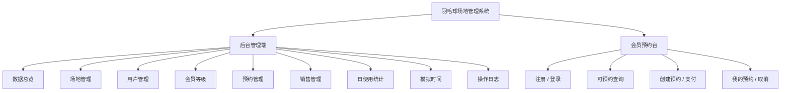
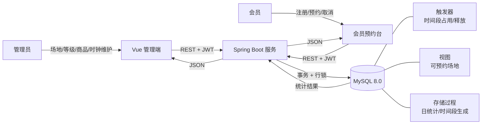
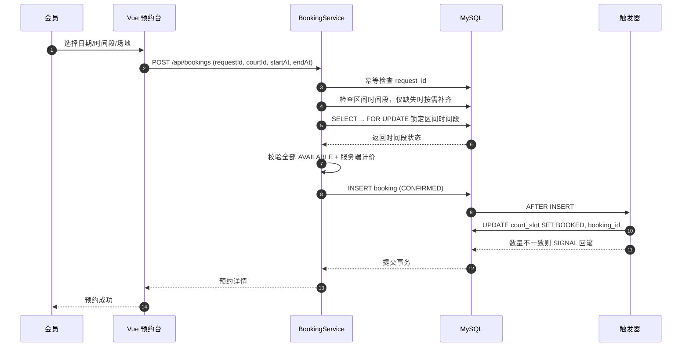
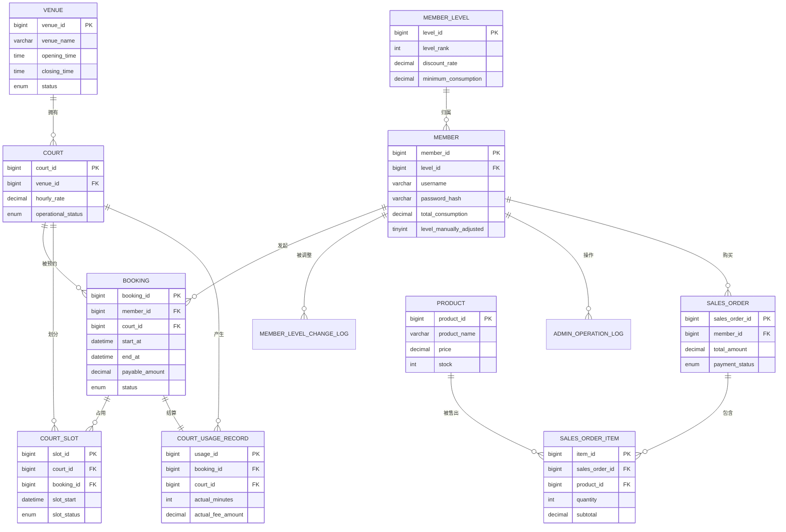
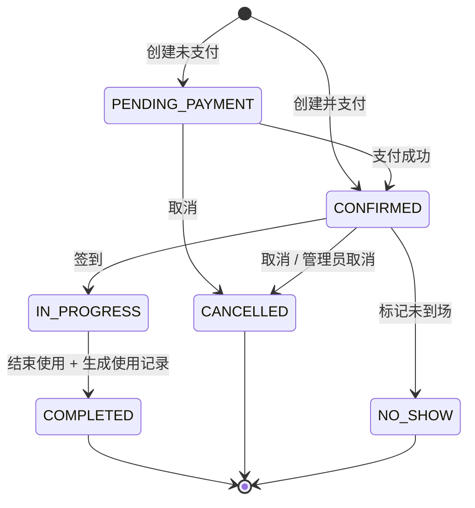

# 羽毛球场地管理系统 · 数据库设计说明书

- 项目名称：星羽羽毛球场地管理系统
- 数据库：MySQL 8.0.28
- 字符集：`utf8mb4 / utf8mb4_0900_ai_ci`
- 数据库名：`badminton_db`
- 文档版本：v1.0（2026-11-19）
- 对应脚本：`database/01_create_database.sql` ~ `database/09_report_queries.sql`

> 本文档中的表、字段、索引、触发器、视图、存储过程均与仓库中的 SQL 脚本及运行中的数据库完全一致。

---

## 1. 项目需求分析

### 1.1 业务背景

羽毛球馆拥有多块独立场地，每块场地有独立的小时单价。用户注册成为会员后，可按日期与时间段预约场地；预约成功后对应时间段被锁定，取消后释放。场馆需要统计每天每块场地的**真实使用时长**与**场地租赁收入**，并与商品零售收入分开核算。

系统同时是数据库课程项目，要求触发器、视图、存储过程真实落地，而不是在 Java 层模拟。

### 1.2 角色与权限

| 角色 | 说明 | 主要权限 |
| --- | --- | --- |
| 游客 | 未登录用户 | 查看场地、场馆、可预约时间段、模拟时钟 |
| 会员 `MEMBER` | 注册用户 | 预约、支付、取消自己的预约、查看自己的预约与资料 |
| 管理员 `ADMIN` | 场馆运营人员 | 全部后台管理接口、手动调级、模拟时钟、统计报表 |

权限控制同时存在于 Spring Security 过滤器链（`/api/admin/**` 需要 `ROLE_ADMIN`）和方法级 `@PreAuthorize`，前端隐藏按钮只是体验优化，不构成安全边界。

### 1.3 功能需求

| 编号 | 模块 | 需求 |
| --- | --- | --- |
| F1 | 场地管理 | 场地增删改查、单价、运营状态、时间段查看与生成、历史使用记录 |
| F2 | 用户管理 | 会员检索、详情、资料修改、禁用/恢复、预约与消费历史 |
| F3 | 会员等级 | 等级配置、折扣、升级门槛、管理员手动调级、变更日志 |
| F4 | 预约管理 | 创建、查询、取消、签到、结束使用、未到场、时间段状态联动 |
| F5 | 销售管理 | 商品、库存、销售单、明细、租赁/商品收入分列统计 |
| F6 | 数据统计 | 总览、日统计（存储过程）、周/月汇总、趋势与使用率 |
| F7 | 模拟时间 | 统一时钟、修改日期时间、暂停/恢复、流速、演示模式 |
| F8 | 操作日志 | 管理员写操作审计 |
| F9 | 会员端 | 注册、登录、可预约查询、下单支付、我的预约、取消 |

### 1.4 非功能需求

- **一致性**：同一场地同一 30 分钟段不可重复占用；并发预约必须由数据库事务与行锁保证。
- **可追溯**：会员等级人工调整必须保留操作人、前后等级、原因、时间。
- **金额精度**：全部金额使用 `DECIMAL`，禁止 `FLOAT/DOUBLE`。
- **安全**：密码 BCrypt 哈希；JWT 身份认证；SQL 全部参数化。
- **可测试**：提供 Swagger、SQL 测试脚本、REST 冒烟测试脚本。
- **时间可控**：演示时可切换业务日期，统计与预约均以统一模拟时钟为准。

---

## 2. 系统功能分析

### 2.1 功能模块



### 2.2 关键业务规则

1. 预约必须对齐 30 分钟，最短 30 分钟，最长 6 小时。
2. 只有 `court.operational_status = 'OPEN'` 且所属场馆 `ACTIVE` 的场地可预约。
3. 预约区间内所有 `court_slot` 必须为 `AVAILABLE` 才能创建。
4. 预约金额由服务端按场地单价快照 × 会员折扣快照计算，前端传入的金额一律忽略。
5. 取消只释放该订单 `booking_id` 对应的时间段；`COMPLETED` 保留 `BOOKED` 作为历史占用。
6. 实际使用时长来自签到/结束使用，不允许用预约时长代替。
7. 人工调级后 `level_manually_adjusted = 1`，自动升级不再覆盖。
8. 统计接口必须传入明确日期，不依赖数据库 `CURDATE()/NOW()`。

---

## 3. 数据流分析

### 3.1 顶层数据流



### 3.2 预约数据流



---

## 4. 概念结构设计

### 4.1 实体

| 实体 | 说明 | 主要属性 |
| --- | --- | --- |
| 场馆 Venue | 一个羽毛球馆 | 名称、地址、电话、营业时间、状态 |
| 场地 Court | 场馆内的独立场地 | 编号、名称、单价、运营状态 |
| 会员等级 MemberLevel | 折扣与升级门槛 | 名称、序号、折扣、门槛 |
| 会员 Member | 注册用户（含管理员） | 用户名、密码哈希、昵称、手机号、角色、累计消费 |
| 预约 Booking | 一次场地预约 | 订单号、起止时间、金额快照、状态、实际起止 |
| 场地时间段 CourtSlot | 30 分钟粒度占用单元 | 开始、结束、状态、关联预约 |
| 实际使用记录 CourtUsageRecord | 一次真实使用与结算 | 实际起止、分钟、计费分钟、金额 |
| 等级变更日志 MemberLevelChangeLog | 等级调整审计 | 前后等级、操作人、原因、类型 |
| 商品 Product | 羽毛球/球拍/饮料等 | 名称、分类、价格、库存 |
| 销售订单 SalesOrder | 商品零售单 | 单号、会员、金额、支付方式 |
| 销售明细 SalesOrderItem | 订单中的商品 | 数量、单价、小计 |
| 系统设置 SystemSetting | 模拟时钟单行配置 | 模拟时间、模式、暂停、流速 |
| 操作日志 AdminOperationLog | 管理端写操作审计 | 操作人、模块、动作、目标、IP |

### 4.2 E-R 图



### 4.3 联系说明

- 场馆与场地：1:N，场地必须属于一个场馆。
- 场地与预约：1:N，同一场地在不同时间段可被多次预约。
- 预约与时间段：1:N，一次 2 小时预约占用 4 个 30 分钟段；时间段通过 `booking_id` 反向归属。
- 预约与实际使用：1:1（`uk_usage_booking` 唯一约束），只有完成使用才产生。
- 会员与等级：N:1，管理员可手动调整并写入日志。
- 销售订单与明细：1:N；商品与明细：1:N。

---

## 5. 逻辑结构设计

### 5.1 关系模式

下划线表示主键，`*` 表示外键。

```
venue(venue_id, venue_name, address, phone, opening_time, closing_time, status, created_at, updated_at)

court(court_id, venue_id*, court_name, court_number, hourly_rate,
      operational_status, description, created_at, updated_at)

member_level(level_id, level_name, level_rank, discount_rate,
             minimum_consumption, description, status, created_at, updated_at)

member(member_id, username, password_hash, nickname, phone, avatar, role,
       level_id*, total_consumption, status, level_manually_adjusted,
       manual_adjusted_at, manual_adjusted_by*, created_at, updated_at)

member_level_change_log(change_id, member_id*, old_level_id*, new_level_id*,
                        operator_id*, change_type, reason, created_at)

booking(booking_id, booking_no, request_id, member_id*, court_id*, start_at, end_at,
        duration_minutes, hourly_rate_snapshot, discount_snapshot, original_amount,
        payable_amount, paid_amount, status, actual_start_at, actual_end_at,
        cancel_reason, created_at, updated_at, cancelled_at)

court_slot(slot_id, court_id*, slot_start, slot_end, slot_status, booking_id*, created_at, updated_at)

court_usage_record(usage_id, booking_id*, court_id*, actual_start_at, actual_end_at,
                   actual_minutes, billed_minutes, actual_fee_amount,
                   settlement_status, created_at, updated_at)

product(product_id, product_name, category, price, stock, status, created_at, updated_at)

sales_order(sales_order_id, order_no, member_id*, total_amount, payment_status,
            payment_method, paid_at, created_at, updated_at)

sales_order_item(item_id, sales_order_id*, product_id*, quantity, unit_price, subtotal)

system_setting(setting_id, simulated_now, base_real_at, clock_mode, clock_paused,
               clock_speed, demo_mode, updated_by*, updated_at)

admin_operation_log(log_id, operator_id*, operator_name, module, action,
                    target_type, target_id, detail, ip, created_at)
```

### 5.2 范式分析

- 所有表均满足 1NF：字段原子，无重复组。
- 满足 2NF：主键均为单列代理键，非主属性完全依赖主键。
- 满足 3NF：非主属性不传递依赖。例如预约表保存 `hourly_rate_snapshot` 与 `discount_snapshot` 属于**有意的反规范化**，用于保留历史成交价格，避免场地调价或会员等级变化后篡改历史金额；这不是传递依赖，而是业务快照。
- `court_slot` 的 `slot_end` 冗余自 `slot_start + 30 分钟`，用于查询可读性与区间过滤，由生成过程保证一致。

---

## 6. 数据表结构说明

### 6.1 venue 场馆表

| 字段 | 类型 | 允许空 | 默认 | 约束/说明 |
| --- | --- | --- | --- | --- |
| venue_id | BIGINT UNSIGNED | 否 | AUTO_INCREMENT | PK |
| venue_name | VARCHAR(100) | 否 | | UNIQUE |
| address | VARCHAR(255) | 否 | | 地址 |
| phone | VARCHAR(30) | 否 | | 联系电话 |
| opening_time | TIME | 否 | 08:00:00 | 营业开始 |
| closing_time | TIME | 否 | 22:00:00 | 营业结束，CHECK > opening_time |
| status | ENUM | 否 | ACTIVE | ACTIVE/SUSPENDED/CLOSED |
| created_at | DATETIME | 否 | CURRENT_TIMESTAMP | |
| updated_at | DATETIME | 否 | ON UPDATE | |

### 6.2 court 场地表

| 字段 | 类型 | 允许空 | 默认 | 约束/说明 |
| --- | --- | --- | --- | --- |
| court_id | BIGINT UNSIGNED | 否 | AUTO_INCREMENT | PK |
| venue_id | BIGINT UNSIGNED | 否 | | FK → venue |
| court_name | VARCHAR(50) | 否 | | 场地名称 |
| court_number | VARCHAR(20) | 否 | | 与 venue_id 组成 UNIQUE |
| hourly_rate | DECIMAL(10,2) | 否 | | 元/小时，CHECK ≥ 0 |
| operational_status | ENUM | 否 | OPEN | OPEN/MAINTENANCE/DISABLED |
| description | VARCHAR(255) | 是 | NULL | |
| created_at / updated_at | DATETIME | 否 | | |

### 6.3 member_level 会员等级表

| 字段 | 类型 | 允许空 | 默认 | 约束/说明 |
| --- | --- | --- | --- | --- |
| level_id | BIGINT UNSIGNED | 否 | AUTO_INCREMENT | PK |
| level_name | VARCHAR(30) | 否 | | UNIQUE |
| level_rank | INT | 否 | | UNIQUE，越大等级越高 |
| discount_rate | DECIMAL(4,2) | 否 | 1.00 | CHECK (0,1] |
| minimum_consumption | DECIMAL(10,2) | 否 | 0.00 | 自动升级门槛 |
| description | VARCHAR(255) | 是 | NULL | |
| status | ENUM | 否 | ENABLED | ENABLED/DISABLED |
| created_at / updated_at | DATETIME | 否 | | |

### 6.4 member 用户表

| 字段 | 类型 | 允许空 | 默认 | 约束/说明 |
| --- | --- | --- | --- | --- |
| member_id | BIGINT UNSIGNED | 否 | AUTO_INCREMENT | PK |
| username | VARCHAR(50) | 否 | | UNIQUE |
| password_hash | VARCHAR(100) | 否 | | BCrypt，禁止明文 |
| nickname | VARCHAR(50) | 否 | | |
| phone | VARCHAR(20) | 否 | | UNIQUE |
| avatar | VARCHAR(255) | 是 | NULL | |
| role | ENUM | 否 | MEMBER | ADMIN/MEMBER |
| level_id | BIGINT UNSIGNED | 否 | | FK → member_level |
| total_consumption | DECIMAL(12,2) | 否 | 0.00 | CHECK ≥ 0 |
| status | ENUM | 否 | ACTIVE | ACTIVE/DISABLED |
| level_manually_adjusted | TINYINT(1) | 否 | 0 | 1=人工指定，自动升级不覆盖 |
| manual_adjusted_at | DATETIME | 是 | NULL | |
| manual_adjusted_by | BIGINT UNSIGNED | 是 | NULL | FK → member |
| created_at / updated_at | DATETIME | 否 | | |

### 6.5 member_level_change_log 等级变更日志

| 字段 | 类型 | 允许空 | 说明 |
| --- | --- | --- | --- |
| change_id | BIGINT UNSIGNED | 否 | PK |
| member_id | BIGINT UNSIGNED | 否 | FK → member，ON DELETE CASCADE |
| old_level_id | BIGINT UNSIGNED | 是 | FK → member_level |
| new_level_id | BIGINT UNSIGNED | 否 | FK → member_level |
| operator_id | BIGINT UNSIGNED | 是 | 管理员；AUTO 时为空 |
| change_type | ENUM | 否 | MANUAL/AUTO |
| reason | VARCHAR(255) | 否 | 修改原因 |
| created_at | DATETIME | 否 | 修改时间 |

### 6.6 booking 预约表

| 字段 | 类型 | 允许空 | 说明 |
| --- | --- | --- | --- |
| booking_id | BIGINT UNSIGNED | 否 | PK |
| booking_no | VARCHAR(32) | 否 | UNIQUE 订单号 |
| request_id | VARCHAR(64) | 是 | UNIQUE 幂等请求 ID |
| member_id | BIGINT UNSIGNED | 否 | FK → member |
| court_id | BIGINT UNSIGNED | 否 | FK → court |
| start_at / end_at | DATETIME | 否 | CHECK end > start |
| duration_minutes | INT | 否 | 30 的倍数 |
| hourly_rate_snapshot | DECIMAL(10,2) | 否 | 成交单价快照 |
| discount_snapshot | DECIMAL(4,2) | 否 | 成交折扣快照 |
| original_amount | DECIMAL(10,2) | 否 | 原价 |
| payable_amount | DECIMAL(10,2) | 否 | 应付 |
| paid_amount | DECIMAL(10,2) | 否 | 实付 |
| status | ENUM | 否 | 见状态机 |
| actual_start_at / actual_end_at | DATETIME | 是 | 实际使用起止 |
| cancel_reason | VARCHAR(255) | 是 | 取消原因 |
| created_at / updated_at / cancelled_at | DATETIME | 否/是 | |

预约状态机：



### 6.7 court_slot 场地时间段表

| 字段 | 类型 | 允许空 | 说明 |
| --- | --- | --- | --- |
| slot_id | BIGINT UNSIGNED | 否 | PK |
| court_id | BIGINT UNSIGNED | 否 | FK → court，ON DELETE CASCADE |
| slot_start | DATETIME | 否 | 时间段开始 |
| slot_end | DATETIME | 否 | 开始 + 30 分钟 |
| slot_status | ENUM | 否 | AVAILABLE/BOOKED/IN_USE/CLOSED |
| booking_id | BIGINT UNSIGNED | 是 | FK → booking，ON DELETE SET NULL |
| created_at / updated_at | DATETIME | 否 | |

唯一约束 `uk_court_slot_start (court_id, slot_start)` 是防止重复占用的最后一道数据库防线。

### 6.8 court_usage_record 实际使用记录表

| 字段 | 类型 | 允许空 | 说明 |
| --- | --- | --- | --- |
| usage_id | BIGINT UNSIGNED | 否 | PK |
| booking_id | BIGINT UNSIGNED | 否 | FK → booking，UNIQUE（一单一记录） |
| court_id | BIGINT UNSIGNED | 否 | FK → court |
| actual_start_at / actual_end_at | DATETIME | 否 | CHECK end > start |
| actual_minutes | INT | 否 | 真实分钟数 |
| billed_minutes | INT | 否 | 按 30 分钟向上取整 |
| actual_fee_amount | DECIMAL(10,2) | 否 | 实际结算金额 |
| settlement_status | ENUM | 否 | UNSETTLED/SETTLED/VOID |
| created_at / updated_at | DATETIME | 否 | |

### 6.9 product 商品表

| 字段 | 类型 | 允许空 | 说明 |
| --- | --- | --- | --- |
| product_id | BIGINT UNSIGNED | 否 | PK |
| product_name | VARCHAR(100) | 否 | UNIQUE |
| category | VARCHAR(30) | 否 | BALL/RACKET/DRINK/ACCESSORY/OTHER |
| price | DECIMAL(10,2) | 否 | CHECK ≥ 0 |
| stock | INT | 否 | CHECK ≥ 0 |
| status | ENUM | 否 | ON_SALE/OFF_SALE |
| created_at / updated_at | DATETIME | 否 | |

### 6.10 sales_order 销售订单表

| 字段 | 类型 | 允许空 | 说明 |
| --- | --- | --- | --- |
| sales_order_id | BIGINT UNSIGNED | 否 | PK |
| order_no | VARCHAR(32) | 否 | UNIQUE |
| member_id | BIGINT UNSIGNED | 是 | FK → member，散客可空 |
| total_amount | DECIMAL(10,2) | 否 | CHECK ≥ 0 |
| payment_status | ENUM | 否 | UNPAID/PAID/REFUNDED |
| payment_method | ENUM | 否 | CASH/WECHAT/ALIPAY/CARD/MIXED |
| paid_at | DATETIME | 是 | |
| created_at / updated_at | DATETIME | 否 | |

### 6.11 sales_order_item 销售明细表

| 字段 | 类型 | 允许空 | 说明 |
| --- | --- | --- | --- |
| item_id | BIGINT UNSIGNED | 否 | PK |
| sales_order_id | BIGINT UNSIGNED | 否 | FK → sales_order，CASCADE |
| product_id | BIGINT UNSIGNED | 否 | FK → product |
| quantity | INT | 否 | CHECK > 0 |
| unit_price | DECIMAL(10,2) | 否 | 成交单价 |
| subtotal | DECIMAL(10,2) | 否 | 小计 |

### 6.12 system_setting 系统设置 / 模拟时钟

| 字段 | 类型 | 允许空 | 说明 |
| --- | --- | --- | --- |
| setting_id | TINYINT UNSIGNED | 否 | PK，固定 1 |
| simulated_now | DATETIME | 否 | 模拟时间基准 |
| base_real_at | DATETIME | 否 | 基准对应的真实时刻 |
| clock_mode | ENUM | 否 | REAL/SIMULATED |
| clock_paused | TINYINT(1) | 否 | 1=冻结 |
| clock_speed | DECIMAL(5,2) | 否 | (0,100] |
| demo_mode | TINYINT(1) | 否 | 演示模式 |
| updated_by | BIGINT UNSIGNED | 是 | FK → member |
| updated_at | DATETIME | 否 | |

### 6.13 admin_operation_log 操作日志

| 字段 | 类型 | 允许空 | 说明 |
| --- | --- | --- | --- |
| log_id | BIGINT UNSIGNED | 否 | PK |
| operator_id | BIGINT UNSIGNED | 是 | FK → member |
| operator_name | VARCHAR(50) | 否 | 操作时昵称快照 |
| module | VARCHAR(30) | 否 | COURT/BOOKING/MEMBER… |
| action | VARCHAR(50) | 否 | 动作编码 |
| target_type / target_id | VARCHAR | 是 | 目标类型与 ID |
| detail | VARCHAR(1000) | 是 | 参数摘要 |
| ip | VARCHAR(45) | 是 | 来源 IP |
| created_at | DATETIME | 否 | |

---

## 7. 主键与外键设计

- 所有表使用无业务含义的 `BIGINT UNSIGNED AUTO_INCREMENT` 代理主键，避免业务键变更。
- 业务唯一键通过 UNIQUE 约束表达：`username`、`phone`、`booking_no`、`request_id`、`order_no`、`(court_id, slot_start)`、`booking_id`（使用记录）。
- 外键动作：
  - 场馆 → 场地：`RESTRICT`，禁止删除仍有场地的场馆。
  - 场地 → 时间段：`CASCADE`，删除无历史场地时清理时间段。
  - 预约 → 时间段：`SET NULL`，预约删除时解除关联。
  - 预约 → 使用记录：`CASCADE`。
  - 销售单 → 明细：`CASCADE`。
  - `member.manual_adjusted_by`、`booking` 等引用会员：`SET NULL` 或 `RESTRICT`，保留历史。
- `member_level_change_log.old_level_id` 允许为空，用于首次调级。

---

## 8. 索引设计

| 表 | 索引 | 列 | 用途 |
| --- | --- | --- | --- |
| venue | uk_venue_name | venue_name | 场馆名唯一 |
| court | uk_court_number | venue_id, court_number | 场馆内编号唯一 |
| court | idx_court_status | operational_status | 开放场地筛选 |
| member_level | uk_level_name / uk_level_rank | level_name / level_rank | 唯一 |
| member | uk_member_username / uk_member_phone | username / phone | 登录与唯一性 |
| member | idx_member_level / idx_member_status | level_id / status | 列表筛选 |
| booking | uk_booking_no / uk_booking_request | booking_no / request_id | 订单号、幂等 |
| booking | idx_booking_member / idx_booking_court | member_id+start_at / court_id+start_at | 我的预约、场地日历 |
| booking | idx_booking_status / idx_booking_created | status / created_at | 状态统计 |
| booking | idx_booking_court_status | court_id, status, start_at | 冲突检查 |
| court_slot | uk_court_slot_start | court_id, slot_start | 唯一占用 |
| court_slot | idx_slot_status_time | slot_status, slot_start | 可预约查询 |
| court_slot | idx_slot_booking | booking_id | 触发释放 |
| court_slot | idx_slot_court_status | court_id, slot_status, slot_start | 场地日历 |
| court_usage_record | uk_usage_booking | booking_id | 一单一记录 |
| court_usage_record | idx_usage_court_time | court_id, actual_start_at | 场地历史 |
| court_usage_record | idx_usage_range | actual_start_at, actual_end_at | 跨日统计 |
| court_usage_record | idx_usage_settle_time | settlement_status, actual_start_at | 日统计过滤 |
| product | uk_product_name / idx_product_category | 名称 / 分类 | 唯一与筛选 |
| sales_order | uk_sales_order_no / idx_sales_paid | 单号 / paid_at | 单据与收入 |
| system_setting | PRIMARY | setting_id | 单行配置 |
| admin_operation_log | idx_log_time / idx_log_module_time | created_at / module+created_at | 日志检索 |

---

## 9. 数据完整性约束

### 9.1 实体完整性
- 所有表主键非空且唯一。
- 业务键 UNIQUE：用户名、手机号、等级名、等级序号、订单号、请求 ID、场地编号、时间段。

### 9.2 参照完整性
- 外键覆盖全部实体联系，见第 7 节。
- `court_slot.booking_id` 指向预约；预约删除时置空，不会留下悬空引用。

### 9.3 用户定义完整性（CHECK）
- `venue.closing_time > opening_time`
- `court.hourly_rate >= 0`
- `member_level.discount_rate > 0 AND <= 1`，`minimum_consumption >= 0`
- `member.total_consumption >= 0`
- `booking.end_at > start_at`，`duration_minutes > 0 AND % 30 = 0`，金额 >= 0
- `court_usage_record.actual_end_at > actual_start_at`，`billed_minutes >= actual_minutes`，`actual_fee_amount >= 0`
- `product.price >= 0`，`stock >= 0`
- `sales_order.total_amount >= 0`，`sales_order_item.quantity > 0`
- `system_setting.clock_speed > 0 AND <= 100`

### 9.4 业务完整性
- 只有 `OPEN` 场地可预约：服务端校验 + 触发器二次校验。
- 时间段必须全部空闲：行锁 + 触发器数量校验。
- 取消只释放本订单：触发器按 `booking_id` 更新。
- 会员等级手动调整必须写日志：Service 事务内同时更新与插入日志。
- 普通用户不可调级：Spring Security 与方法级权限。

---

## 10. 触发器设计

### 10.1 trg_booking_after_insert

**时机**：`AFTER INSERT ON booking`  
**作用**：`status = 'CONFIRMED'` 时占用区间内全部 30 分钟段。

逻辑：

1. 校验时间对齐 30 分钟、场地为 `OPEN`。
2. `v_needed = duration_minutes / 30`。
3. 统计区间内 `AVAILABLE` 且 `booking_id IS NULL` 的时间段数量。
4. 数量不等于 `v_needed` 则 `SIGNAL SQLSTATE '45000'`，整个 INSERT 回滚。
5. `UPDATE court_slot SET slot_status='BOOKED', booking_id=NEW.booking_id`。
6. `ROW_COUNT()` 与需求数量不一致时再次 SIGNAL。

### 10.2 trg_booking_after_update

**时机**：`AFTER UPDATE ON booking`  
**作用**：状态流转时同步时间段。

| 状态变化 | 动作 |
| --- | --- |
| `PENDING_PAYMENT → CONFIRMED` | 校验并占用区间时间段（幂等：已占用则跳过） |
| `* → IN_PROGRESS` | 本订单时间段改为 `IN_USE` |
| `* → CANCELLED` | 本订单时间段恢复 `AVAILABLE`，`booking_id=NULL` |
| `* → NO_SHOW` | 释放本订单时间段 |
| `* → COMPLETED` | 保留 `BOOKED`，作为历史占用记录 |

只按 `booking_id = NEW.booking_id` 更新，**不会**误释放其他订单的时间段。

### 10.3 trg_booking_before_update

**时机**：`BEFORE UPDATE ON booking`  
**作用**：禁止修改已创建预约的 `court_id / start_at / end_at / duration_minutes`，避免时间段与订单不一致。如需改期必须取消后重新预约。

> MySQL 限制：触发器内不更新 `booking` 表本身，只更新 `court_slot`，避免 "Can't update table already used by statement"。

完整 SQL 见 `database/04_create_triggers.sql`，测试见 `database/08_test_cases.sql` 测试一、二、三。

---

## 11. 视图设计

### 11.1 v_available_court_slots

```sql
CREATE OR REPLACE VIEW v_available_court_slots AS
SELECT v.venue_id, v.venue_name,
       c.court_id, c.court_name, c.court_number, c.hourly_rate,
       s.slot_id, s.slot_start, s.slot_end, s.slot_status
FROM court_slot s
JOIN court c ON c.court_id = s.court_id
JOIN venue v ON v.venue_id = c.venue_id
WHERE s.slot_status = 'AVAILABLE'
  AND c.operational_status = 'OPEN'
  AND v.status = 'ACTIVE';
```

过滤条件：时间段空闲 + 场地开放 + 场馆正常。视图本身不带时间参数，由查询方通过 `WHERE` 指定区间；这样同一个视图可以查询任意未来日期，而不是仅判断“当前”。

### 11.2 查询 2026-11-20 14:00-16:00 可预约场地

```sql
SELECT venue_id, venue_name, court_id, court_name, hourly_rate, COUNT(*) AS free_slots
FROM v_available_court_slots
WHERE slot_start >= '2026-11-20 14:00:00'
  AND slot_end   <= '2026-11-20 16:00:00'
GROUP BY venue_id, venue_name, court_id, court_name, hourly_rate
HAVING COUNT(*) = 4;
```

`HAVING COUNT(*) = 4` 保证整个 2 小时区间的 4 个 30 分钟段全部空闲，而不是“部分空闲”。

### 11.3 其他视图

- `v_booking_detail`：预约 + 会员 + 等级 + 场地 + 使用记录，后台详情使用。
- `v_member_consumption_history`：`UNION ALL` 场地租赁与商品消费，会员详情使用。

---

## 12. 存储过程设计

### 12.1 sp_generate_court_slots(p_from_date, p_to_date)

- 游标遍历所有未停用场地及其场馆营业时间。
- 按 30 分钟步长 `INSERT IGNORE` 到 `court_slot`。
- 已存在的时间段自动跳过，可重复执行。
- 返回 `from_date / to_date / inserted_slots / total_slots`。

后台“生成未来时间段”按钮直接调用该过程；创建场地时也会自动生成未来 30 天。

### 12.2 sp_daily_court_stats_by_court(p_stat_date, p_court_id)

统计某场地某自然日的真实使用：

```sql
overlap_minutes = TIMESTAMPDIFF(
    MINUTE,
    GREATEST(u.actual_start_at, p_stat_date 00:00:00),
    LEAST(u.actual_end_at, p_stat_date + 1 天 00:00:00)
)

overlap_fee = u.actual_fee_amount * overlap_minutes / u.actual_minutes
```

- 只统计 `settlement_status <> 'VOID'` 且与当天有交集的记录。
- 使用 `LEFT JOIN court`，无记录时返回 0，而不是没有行。
- 跨自然日按重叠分钟比例拆分金额，两天合计等于原金额。

调用：

```sql
CALL sp_daily_court_stats_by_court('2026-11-18', 1);
```

### 12.3 sp_daily_court_stats_all(p_stat_date)

同样的重叠算法，不按场地分组，返回：

`stat_date, total_actual_minutes, total_actual_hours, total_sales_amount, used_court_count, usage_record_count`

无数据时 `COALESCE` 返回 0。

调用：

```sql
CALL sp_daily_court_stats_all('2026-11-18');
```

后台 `GET /api/admin/reports/daily/court?date=` 的实现：

1. 查询全部场地列表；
2. 对每个场地调用 `sp_daily_court_stats_by_court`，保证零使用场地也显示 0；
3. 调用 `sp_daily_court_stats_all` 得到汇总行。

---

## 13. 模拟时钟设计

| 配置 | 含义 |
| --- | --- |
| `simulated_now` | 模拟时间基准点 |
| `base_real_at` | 设置基准点时的真实时间 |
| `clock_mode` | `SIMULATED` 使用模拟时间；`REAL` 使用服务器真实时间 |
| `clock_paused` | 暂停后有效时间冻结在基准点 |
| `clock_speed` | 时间流速，例如 60 表示真实 1 秒 = 模拟 1 分钟 |
| `demo_mode` | 演示模式标记 |

计算：

```
effectiveNow = simulatedNow + (realNow - baseRealAt) × clockSpeed   （未暂停且 SIMULATED）
effectiveNow = simulatedNow                                        （暂停）
effectiveNow = realNow                                             （REAL）
```

修改时钟时，先把当前有效时间冻结为新的 `simulated_now`，再刷新 `base_real_at`，避免时间跳变。

业务代码统一通过 `SimulatedClockService.now()`；存储过程不读取 `NOW()`，统计日期由接口参数传入。

---

## 14. 测试数据

`07_seed_data.sql` 相对 `CURDATE()` 生成，任何日期执行都可用。

| 数据 | 内容 |
| --- | --- |
| 场馆 | 1 个：星羽羽毛球馆，08:00-23:30 |
| 场地 | 7 块：1-5 开放，6 维护，7 停用；单价 60/80/100/120 |
| 等级 | 普通 1.00、银卡 0.95（1000）、金卡 0.90（3000）、钻石 0.85（8000） |
| 会员 | 管理员 1 名 + 会员 8 名（含 1 名禁用、1 名人工调级） |
| 时间段 | 过去 7 天 ~ 未来 30 天，6 块未停用场地 × 38 天 × 31 段 = 7068 条 |
| 预约 | 12 条：已完成 4、使用中 1、已确认 4、已取消 1、待支付 1、未到场 1 |
| 使用记录 | 4 条，其中 1 条跨自然日（22:30 → 次日 00:30） |
| 商品 | 6 种，含 1 种下架 |
| 销售单 | 4 张：3 张已支付、1 张未支付 |
| 操作日志 | 3 条（调级、场地维护、取消预约） |

关键预期值：

- 昨日（2026-11-18）场地租赁收入 **369.00 元**，实际使用 **290 分钟（4.83 小时）**。
- 今日（2026-11-19）场地租赁收入 **198.00 元**，实际使用 **120 分钟（2.00 小时）**。
- 今日商品收入 **80.00 元**（仅统计已支付订单）。
- 跨日订单合计 **180.00 元**：昨日 135.00（90 分钟）+ 今日 45.00（30 分钟）。

---

## 15. 数据库测试结果

执行命令：

```bash
mysql -h127.0.0.1 -P3307 -uroot -proot123 \
  --default-character-set=utf8mb4 --table --force < database/08_test_cases.sql
```

| 编号 | 测试内容 | 预期 | 实际 | 结果 |
| --- | --- | --- | --- | --- |
| 1 | 预约成功触发器占场 | 12:00/12:30 变为 BOOKED 且 booking_id=新订单 | 两段均 BOOKED，booking_id=13 | 通过 |
| 2 | 取消只释放自身时间段 | A 释放，B 保持 BOOKED | 14:00/14:30 AVAILABLE，15:00/15:30 BOOKED(#15) | 通过 |
| 3 | 重复预约拦截 | 第二次报错 | “预约失败：所选时间段已被占用或尚未初始化” | 通过 |
| 4 | 视图查询空闲场地 | 明日 14-16 返回 5 块；11-13 排除 3 号 | 5 块 / 4 块 | 通过 |
| 5 | 单场地日统计 | 1 号 110 分钟 120.00；3 号 90 分钟 135.00；5 号 0 | 与预期一致 | 通过 |
| 6 | 全部场地汇总 | 昨日 290 分钟 369.00；今日 120 分钟 198.00；空日期 0 | 与预期一致 | 通过 |
| 7 | 人工调级写日志 | 等级 2→3，标记 1，日志 1 条 | 与预期一致 | 通过 |
| 8 | 普通用户调级被拒 | HTTP 403 | 403 “无权限执行该操作” | 通过 |
| 9 | 模拟时间切换 | 业务日期 +3 天，时间段已预生成 | 2026-11-22，186 段 | 通过 |
| 10 | 跨自然日拆分 | 135.00 + 45.00 = 180.00 | 与预期一致 | 通过 |

完整输出与 REST 测试结果见 [`测试记录.md`](测试记录.md)。

---

## 16. 设计一致性说明

- 本文档字段与 `02_create_tables.sql` 一一对应。
- 触发器、视图、存储过程名称与 `04~06` 脚本一致，且已在 MySQL 8.0.28 实际创建。
- 后端 Mapper 调用的过程名、参数顺序与脚本一致。
- 前端“日使用统计”页面展示的数据来自 `sp_daily_court_stats_by_court / sp_daily_court_stats_all`，不是前端模拟。
- 金额字段全部为 `DECIMAL`，Java 对应 `BigDecimal`。
